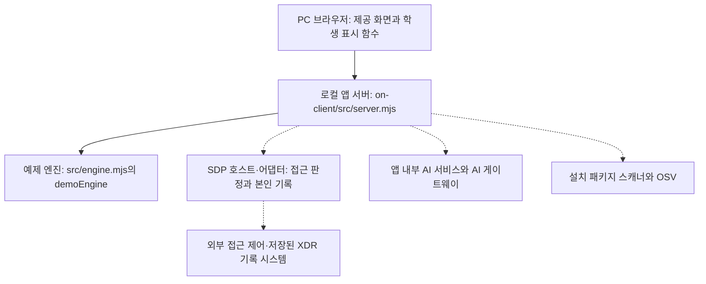

# keshev-agent 학생 실행 설명서와 시스템 구성도

## 1. 목적과 지원 범위

keshev-agent는 본인의 사용자·기기·세션, 업무 앱 접근 판정, 보안 기록,
AI 연결 점검·사건 설명, 조치 상태, 설치 패키지 취약점 조회 결과를 표시하는 학생 앱입니다.

포털에 저장한 이름은 keshev-agent입니다.
제공 앱의 화면과 시작 메시지는 케셰브로 표시될 수 있습니다.
포털 이름 변경은 이미 받은 파일이나 앱 제목을 자동 변경하지 않습니다.

이 문서는 저장소 안의 on-client 앱을 다룹니다.
저장소 최상위의 기존 자료실·판정기·탐지기·복구 기능과 Git 기록은 보존합니다.
로컬 서버 실행, 예제 화면, 실제 외부 연결, 공식 과제 판정은 서로 다른 확인 대상입니다.

## 2. 지원 환경과 확인한 버전

| 항목 | 기준과 확인 결과 |
|---|---|
| 운영 환경 | Windows PC와 PowerShell에서 실행·예제 화면 확인. 정확한 Windows 버전은 미기록 |
| 시작 틀 | on-client/package.json의 alekov-client-starter 0.2.11 |
| Node.js | package.json의 engines.node와 제공 검수 기준은 24.19.0 |
| 실행 도구 허용 범위 | tools/start-alekov.ps1은 Node.js 주 버전 22~24를 검사 |
| 실제 Node.js | v24.22.0 출력과 예제 실행 확인 |
| Git | git version 2.56.0.windows.2 출력 확인 |
| npm | 버전 미확인. npm 명령은 npm.ps1 실행 정책 오류가 발생함 |
| PowerShell | 사용 확인. 정확한 버전은 미기록 |
| 브라우저 | PC 브라우저에서 예제 화면·개발자 도구 모의 검사 확인. 정확한 버전은 미기록 |
| 다른 환경 | macOS·Linux·다른 Node.js 버전·모바일에서의 재현은 미확인 |

## 3. 실제 작업 위치와 폴더 구조

현재 Git 프로젝트 최상위:

C:\Users\Administrator\Downloads\keshev-defense

현재 앱 실행 폴더:

C:\Users\Administrator\Downloads\keshev-defense\on-client

다른 PC에서는 실제로 받은 저장소 위치로 경로를 바꿉니다.
예전 다운로드 원본 폴더 대신 누적 작업한 이 저장소를 사용합니다.

| 저장소 기준 경로 | 역할 |
|---|---|
| README.md | 기존 단계 기록과 학생 문서 안내 |
| docs/STUDENT_RUNBOOK.md | 이 학생 실행 설명서 |
| package.json / package-lock.json | 기존 루트 프로젝트의 실행·의존성 자료. on-client의 lock 파일로 간주하지 않음 |
| src / api / public / xdr | 기존 자료실·서버·판정·탐지 관련 파일 |
| on-client/package.json | 학생 앱 실행 명령과 시작 틀 버전 |
| on-client/src/server.mjs | 제공 로컬 HTTP 서버 |
| on-client/src/engine.mjs | 예제 엔진과 연결 어댑터 로딩 |
| on-client/student/engine-adapter.mjs | 제공 연결 어댑터. 기본 export는 disconnected |
| on-client/student/extension.mjs | 학생 표시 함수 |
| on-client/public/app.js | 제공 화면, API 요청, 상태 전달, 취소·응답 세대 관리 |
| on-client/src/engine/sdp-host.mjs | 제공 SDP 연결 모듈 |
| on-client/src/ai | 제공 앱 내부 AI 서비스 |
| on-client/src/actions | 제공 조치 서비스 |
| on-client/src/vulnerabilities | 제공 설치 패키지·OSV 조회 서비스 |
| on-client/tools/start-alekov.ps1 | 제공 실행 도구 |
| on-client/.env.example | 비밀 없는 설정 견본 |
| on-client/docs | 제공 계약·실행·연결 안내 |

on-client에는 외부 npm 의존성이 없다고 제공 README에 명시되어 있습니다.
현재 on-client에는 package-lock.json이 없습니다.
예제 실행을 위해 루트 프로젝트에서 npm install을 실행할 필요는 없습니다.
패키지나 lock 파일을 새로 만들거나 의존성 버전을 변경하지 않습니다.

## 4. 준비와 예제 실행

Node.js와 Git이 설치된 PC에서 누적 프로젝트 전체를 준비합니다.
부분 파일만 복사해 기존 학생 코드를 덮어쓰지 않습니다.

파일 탐색기에서 on-client 폴더를 연 뒤 주소 표시줄에 powershell을 입력하면
해당 폴더에서 PowerShell을 열 수 있습니다.

확인 명령:

```powershell
cd "C:\Users\Administrator\Downloads\keshev-defense\on-client"
node --version
git --version
node --check .\student\extension.mjs
```

문법 검사는 성공하면 출력이 없으며, 앱 실행이나 외부 연결을 확인하지 않습니다.
npm 버전이 필요할 때는 npm.cmd --version을 사용해 확인합니다.
npm.ps1 오류를 해결하려고 전역 실행 정책을 변경하지 않습니다.

직접 실행을 확인한 예제 명령:

```powershell
cd "C:\Users\Administrator\Downloads\keshev-defense\on-client"
node .\src\server.mjs --demo
```

기본 포트 5189에서 확인한 시작 메시지:

```text
케셰브 예제: http://127.0.0.1:5189
```

실행 창을 유지하고 브라우저에서 다음 주소를 엽니다.

http://127.0.0.1:5189/

보호 현황·업무 앱·보안 기록과 학생 구현 표시를 확인합니다.
예제 데이터(demo) · 실제 연결 아님 표시는 실제 연결 성공이 아닙니다.
서버 시작 메시지만으로 로그인·SDP·AI·OSV 연결 성공을 인정하지 않습니다.

## 5. 제공 실행 도구와 기본 모드

다음 명령은 제공 코드와 문서를 읽어 확인했으며,
이 문서의 새 환경 재현 절차로 직접 실행한 결과는 아직 미확인입니다.

```powershell
cd "C:\Users\Administrator\Downloads\keshev-defense\on-client"
powershell -NoProfile -ExecutionPolicy Bypass -File .\tools\start-alekov.ps1 -Demo
```

도구는 Node.js·폴더·포트를 검사하고 서버 응답을 기다립니다.
정상 응답 시 케셰브가 켜졌다는 문구와 브라우저 주소를 표시합니다.
ExecutionPolicy Bypass는 해당 PowerShell 프로세스에만 적용합니다.

-Demo를 빼면 기본 연결 확인 모드입니다.
설정이 없으면 실제 외부 시스템에 연결된 것으로 보지 않습니다.
package.json의 start는 node src/server.mjs,
demo는 node src/server.mjs --demo,
check는 node --check student/extension.mjs에 해당합니다.

NativeHostConfig와 SdpHostConfig는 서로 다른 제공 실행 옵션입니다.
담당자가 안내한 본인용 설정이 있을 때만 제공 연결 안내를 따릅니다.
이 문서에는 설정 내용·인증서·개인키·토큰을 넣지 않습니다.
예제 모드와 SDP 연결을 함께 사용하지 않습니다.

## 6. 종료와 재실행

1. 서버를 실행한 PowerShell 창에서 Ctrl+C를 누릅니다.
2. 별도 PowerShell에서 아래 명령으로 5189의 수신 프로세스가 남았는지 확인합니다.
3. 종료를 확인한 뒤 같은 앱 폴더에서 예제 실행 명령을 다시 실행합니다.
4. 브라우저를 새로고침하고 예제 표시와 학생 영역을 확인합니다.

```powershell
Get-NetTCPConnection -LocalPort 5189 -State Listen -ErrorAction SilentlyContinue
```

브라우저 탭만 닫는 것은 서버 종료가 아닙니다.
기존 화면이 캐시에 남아 있을 수 있으므로 화면 모양만으로 종료를 판단하지 않습니다.
2026-10-26 서버 종료 뒤 5189 수신 항목이 없음을 확인하고, 같은 명령으로 재실행한 뒤 예제 보호 현황 화면을 확인했습니다.
다른 프로그램이나 소유자를 확인하지 않은 프로세스를 강제로 종료하지 않습니다.

## 7. 시스템 구성도

실선은 로컬 화면과 서버 관계, 점선은 별도 준비와 권한이 필요한 외부 연결 경로입니다.
점선은 현재 실제 연결 성공을 뜻하지 않습니다.



경로는 별도 언급이 없으면 on-client 기준입니다.

| 흐름 | 역할과 경계 |
|---|---|
| 브라우저 → 로컬 앱 서버 | 제공 public/app.js가 같은 로컬 서버의 API를 호출하고 상태를 학생 함수에 전달 |
| 학생 함수 → 화면 | 전달된 자료를 createElement와 textContent로 표시. 운영 인증·판정·집행을 대신하지 않음 |
| 로컬 서버 → 예제 엔진 | --demo에서 제공 가상 사용자·앱·기록·판정을 사용 |
| 로컬 서버 → SDP 호스트·어댑터 → 외부 시스템 | 담당자가 준비한 설정·권한이 필요. 실제 연결은 미확인 |
| 로컬 서버 → AI 서비스 → AI 게이트웨이 | 앱 내부 연결 점검과 사건 설명. 모델 목록 응답과 실제 설명 호출은 별도 |
| 로컬 서버 → 패키지 스캐너 → OSV | 승인된 공개 패키지만 조회. 공개 출처는 https://api.osv.dev/v1/querybatch |
| 과제 제출 → ALEPH 판정 AI | 제출 커밋을 읽는 공식 과제 판정. 앱 내부 AI 호출·앱 실행 결과와 별도 |

학생 화면에서 외부 시스템의 비밀 주소나 인증 정보를 직접 입력하지 않습니다.
서버 기능과 연결 어댑터가 있다는 사실만으로 실제 접근 제어·XDR·AI·조치가 연결됐다고 쓰지 않습니다.
XDR 목록은 이미 저장된 경보이며 화면을 열 때 새로 탐지하는 기능이 아닙니다.

## 8. 제공 코드와 학생 작성 기능

학생 작성 대상은 on-client/student/extension.mjs의 표시 함수입니다.
engine-adapter.mjs를 포함한 제공 연결 코드와 public/app.js를 학생 성취로 계산하지 않습니다.

| 학생 함수 | 구현한 표시 기능 | 확인 범위 |
|---|---|---|
| renderIdentity | 사용자·기기·세션, 원래 상태와 한국어 설명 | 예제 화면 확인 |
| renderDecision | 요청 전·중·실패, allow·deny·challenge·unknown, 이유·시각 | 예제 deny·challenge 및 연결 실패 화면 확인 |
| renderEvents | 최신순 목록, 세 필터, 근거·규칙·세 상태 상세 | 예제 화면과 모의 데이터 확인 |
| renderStatus | 로딩·빈 목록·오류, 알림, 진단 항목 복사 | 예제·연결 실패 화면과 모의 데이터 확인 |
| renderAiConnection | 연결 점검 상태, test·verified, 오류별 안내 | idle 화면과 모의 데이터 확인. 실제 AI 연결은 미확인 |
| renderExplanation | 참고용 요약, 현재 근거 ID 대조, 규칙·unknown·미실행 제안 | 모의 데이터 확인. 실제 AI 설명 호출은 미확인 |
| renderAction | 준비·전송·ACK·효과 관측·결과 불명 구분 | 모의 데이터 확인. 실제 집행·효과는 미확인 |
| renderVulnerabilities | 정확한 전달 버전·출처·시각·ID, 미조회·일부 실패 구분 | not_configured 화면과 모의 데이터 확인 |

조회 요청·취소·늦은 응답 차단은 제공 코드의 역할입니다.
public/app.js는 취소 시 요청 세대를 증가시키고 응답 세대가 다르면 결과를 버립니다.
취소 후 늦은 응답을 전달한 브라우저 모의 검사에서 취소 화면 유지가 확인됐습니다.
이는 실제 OSV 외부 조회를 실행한 결과가 아닙니다.

## 9. 장애 확인과 복구 안내

| 증상·코드 | 확인 순서 | 복구와 예상 결과 |
|---|---|---|
| node 명령 없음 | 새 PowerShell에서 node --version 확인 | 제공 안내의 Node.js를 설치한 뒤 새 창에서 재확인 |
| npm.ps1 실행 정책 오류 | npm.cmd --version으로 실행 파일 확인 | npm.cmd를 사용하거나 위 직접 node 실행 사용. 전역 정책 변경 불필요 |
| EADDRINUSE | 5189 수신 여부와 기존 앱 실행 창 확인 | 이미 실행한 앱이면 기존 주소 사용. 새 서버를 반복 실행하지 않음 |
| 포트가 다른 프로그램에서 사용 중 | 프로그램을 종료하지 않고 제공 실행 도구 옵션 확인 | -Port 5190으로 실행하면 브라우저 주소도 http://127.0.0.1:5190/ 사용. 이 대체 실행은 미확인 |
| 로컬 서버 연결 실패 / NETWORK_ERROR | 서버 창·포트·브라우저 주소 확인 | 서버 실행을 확인한 뒤 사용자가 다시 불러오기 또는 해당 조회 버튼을 직접 누름 |
| NATIVE_HOST_DISABLED | 현재 실행에 계정 연결 설정이 있는지 담당자 확인 | 학생 코드만으로 해결하지 않음. 공식 설정 준비 후 제공 승인 순서 진행 |
| AI 인증·권한·한도 오류 | 학생 AI 영역의 안전한 코드와 안내 확인 | 계정 연결·앱 권한·이용 한도를 담당자에게 확인. 자동 재요청 없음 |
| TIMEOUT / CANCELLED | 현재 조회가 시간 초과·취소됐는지 확인 | 이전 결과를 현재 결과로 보지 않고 필요하면 사용자가 직접 재조회 |
| CONTRACT_MISMATCH | 제공 계약과 응답 형식 확인 | 정상·빈 결과로 처리하지 않음. 안전한 코드와 상황을 담당자에게 전달 |
| PROJECT_NOT_CONFIGURED / not_configured | 조회 대상 프로젝트 설정 여부 확인 | 담당자에게 확인. 취약점 없음이나 조회 완료로 보지 않음 |
| not_checked | 승인된 공개 조회 대상 여부 확인 | 학생이 허용 목록을 임의로 변경하지 않음 |
| OSV partial / 패키지 unverifiable | 받은 취약점 ID와 실패 안내를 함께 확인 | 이미 받은 ID 유지. 전체 조회 성공·안전으로 단정하지 않음 |
| 학생 표시가 이전 코드처럼 보임 | 저장 여부와 현재 실행한 프로젝트 위치 확인 | 앱 탭을 닫고 새 탭에서 다시 열어 확인. 모듈 URL에 임의 query를 붙이지 않음 |

진단은 제공 도움정보 영역의 도움정보 불러오기로 조회합니다.
학생 도움정보 복사는 requestId·component·version·checkedAt·engine.mode·engine.code만 대상으로 합니다.
키·토큰·비밀번호·개인키와 실제 개인정보를 캡처·문서·Git·제출 묶음에 넣지 않습니다.
임의 모델·대체 연결·권한 우회·시험 목적의 실제 보안 조치 요청을 추가하지 않습니다.

## 10. 확인 상태와 남은 점검

| 구분 | 상태 |
|---|---|
| 기존 실행 기록 | Windows PowerShell에서 Node.js v24.22.0 예제 실행과 로컬 화면 확인 |
| 코드 읽기 | package.json, 제공 실행 도구, 서버 시작 부분, 어댑터, 예제 엔진 대조 |
| 모의 검사 | 학생 표시 상태, 근거 대조, 조치 결과 구분, 패키지 표시, 취소 후 늦은 응답 차단 확인 |
| 이번 문서 절차 재현 | 2026-10-26 예제 실행·종료 후 포트 해제·재실행과 보호 현황 화면 확인. 다른 PC 재현은 미확인 |
| 실제 환경 | 실제 SDP·XDR 연결, 앱 내부 AI 호출, 실제 조치 집행·효과 확인 미확인 |
| 실제 OSV | 프로젝트 미설정 화면 확인. 실제 lock·설치 버전 대조 및 외부 조회 미확인 |
| 다른 환경 | 다른 PC·운영체제·Node.js 버전 재현 미확인 |

모의 자료의 버전·해시는 실제 설치 버전과 실제 lockfileHash의 증거가 아닙니다.
OSV에서 알려진 항목이 없더라도 패키지나 앱 전체의 안전을 보장하지 않습니다.
세션 조회는 현재 검증된 연결 하나이며 과거 세션 전체 목록이 아닙니다.
앱 접근 allow는 정책상 허용이며 실제 업무 앱 접속 성공을 보장하지 않습니다.
AI 설명·제안은 참고 정보이며 보안 조치 실행이 아닙니다.
조치 화면 취소는 이미 서버에 전달된 조치 효과를 되돌리지 않습니다.

## 11. 21단계 커밋과 제출

현재 공식 21단계 안내를 따릅니다.
제공 STUDENT_LAUNCH_GUIDE.md의 이전 제출 설명 중
21·22단계 방식이 미확정이라는 부분은 현재 과제 화면 안내로 대체해 읽습니다.

1. Git 최상위 폴더에서 git status와 git diff로 변경 파일을 확인합니다.
2. 기존 작업을 보존하고 이번 학생 문서와 README의 학생 안내를 같은 커밋에 저장합니다.
3. 비밀값을 검사하고 제출할 파일을 확인한 뒤 커밋합니다.
4. 21·22단계는 과제 화면에 저장소 주소와 실제 40자리 커밋을 직접 입력합니다.
5. 비공개 원문이 필요하면 과제 화면의 원문 전달 도구를 프로젝트 밖에 압축 해제합니다.
6. 출력 JSON도 프로젝트 밖의 새 폴더에 만듭니다.
7. 실제 도구 위치와 제출 커밋을 확인한 뒤 공식 명령의 --commit에 그 커밋을 지정합니다.
8. 같은 단계에서 JSON·저장소·커밋을 대조한 뒤 사용자가 제출합니다.
9. 원문 전달 완료·AI 검토 통과·로컬 실행 성공을 각각 구분합니다.

현재 워크벤치의 포털 제출 준비는 13~20단계용입니다.
비공개 저장소를 공개로 바꿀 필요는 없습니다.
원문 도구는 커밋된 원문을 묶으며 학생 코드를 실행하지 않습니다.
구체적인 제출 명령은 실제 도구 경로와 최종 커밋을 확인한 후 과제 화면 안내대로 작성합니다.
이 문서만으로 제출·공식 통과·실제 외부 연결 완료를 주장하지 않습니다.

## 12. 기존 자기 점검의 공개용 키 설정

src/attack-check.mjs는 SUPABASE_PUBLISHABLE_KEY 환경변수를 사용합니다.
프로세스에 값이 없고 저장소 최상위 .env가 있으면 해당 파일을 읽습니다.
실제 값은 Git에서 제외되는 로컬 .env에만 보관합니다.
루트 .env.example에는 SUPABASE_PUBLISHABLE_KEY=만 기록합니다.
다른 PC에서는 본인 프로젝트의 공개용 키를 로컬 설정에 직접 넣으며 대화나 Git에 기록하지 않습니다.
값이 없으면 직접 Data API 조회 점검은 요청을 보내지 않고 미실행으로 남깁니다.
이 설정은 on-client 예제 실행에는 필요하지 않습니다.
이번 변경의 문법 검사는 확인했으며, 변경 후 실제 외부 자기 점검은 미실행입니다.
